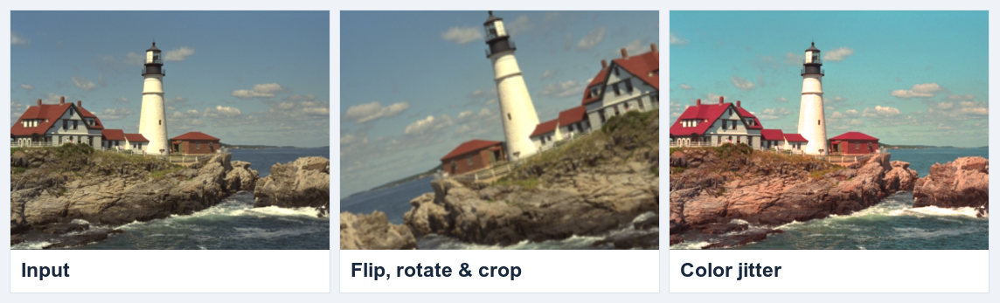
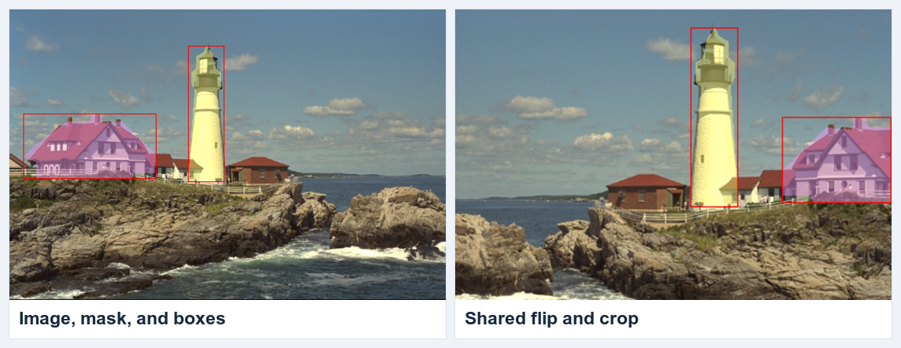
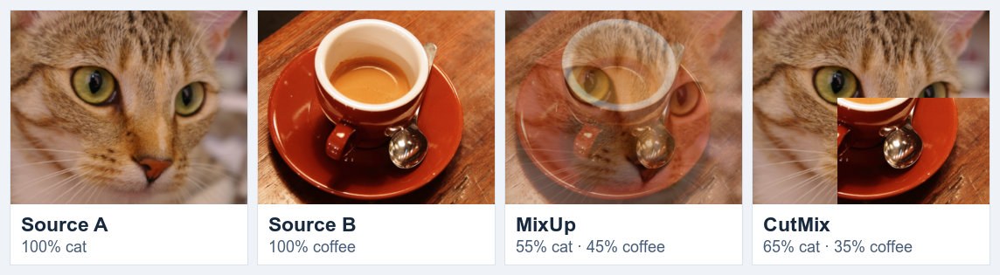

# DataAugmentation.jl

[](https://fluxml.ai/DataAugmentation.jl/stable/)
[](https://fluxml.ai/DataAugmentation.jl/dev/)
[](https://github.com/FluxML/DataAugmentation.jl/actions/workflows/ci.yml?query=branch%3Amaster)
[](https://codecov.io/gh/FluxML/DataAugmentation.jl)
[](https://github.com/JuliaTesting/Aqua.jl)

Compose data augmentation pipelines for image classification, segmentation, object detection, and 3D volumes in Julia.



## Quickstart

Install the registered package and the sample images used below.

```julia
using Pkg
Pkg.add(["DataAugmentation", "TestImages"])
```

Compose a random rotation and crop with `|>`. Use `itemdata` to get the resulting pixel array.

```julia
using DataAugmentation, TestImages

image = Image(testimage("lighthouse"))
tfm = Rotate(15) |> RandomResizeCrop((192, 256))
pixels = itemdata(tfm(image))
```

## Feature showcase

### Keep annotations aligned

Pass aligned items as a tuple with `tfm((image, mask, boxes))` to share the random geometry. Here `FlipX` and `RandomIoUCrop` move the segmentation mask and labeled boxes with the image.



### Mix images and labels

`MixUp` blends paired images. `CutMix` copies a rectangular patch from one image into another. Both return an `ImageBatch` with class weights that reflect the mix.



## Documentation

- Browse crops, warps, color transforms, and policies such as `RandAugment` and `AutoAugment`. [Transformations](https://fluxml.ai/DataAugmentation.jl/dev/transformations/)
- Run complete examples for masks, keypoints, boxes, and volumes. [Pipelines](docs/src/pipelines.md)
- Prepare image tensors, load batches, and train a model. [Using with Flux](docs/src/flux.md)
